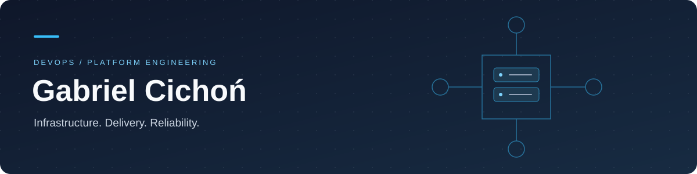

  

  <strong>DevOps Engineer · Platform Engineer · Cloud Infrastructure</strong> 
  Poland · <a href="mailto:elbajcyko@gmail.com">Get in touch</a> · <a href="https://github.com/GCICHON-DEV?tab=repositories">Explore my repositories</a>

---

## Infrastructure experience. Software mindset.

I work where infrastructure, software delivery and production operations meet. At CloudForge, I am the sole DevOps engineer for a Kubernetes-based platform, responsible for the systems and tooling behind application deployments.

My background spans production systems administration, networking and business application integrations. That helps me investigate a problem across the whole path: application, database, storage, operating system and network.

## What I bring to a platform team

| Focus | Practical experience |
| --- | --- |
| **Platform ownership** | Kubernetes workloads, Helm deployments, ingress, networking and persistent storage |
| **Repeatable delivery** | Terraform and Ansible automation, reusable GitLab pipelines and approval-based environment promotion |
| **Operational visibility** | Metrics, logs, traces and profiling, connected to hands-on incident investigation |
| **Security & recovery** | Secrets and identity integrations, service hardening, scheduled backups and recovery documentation |

## Work I've delivered

### Delivery workflows that teams can reuse

Designed and implemented GitLab CI/CD templates covering testing, Sonar analysis, semantic-release versioning and Docker builds. Standardised deployments and environment promotion, while operating the supporting GitLab CE, containerised Runners and Harbor services.

### Infrastructure from configuration to operations

Automated provisioning and configuration across AWS, Azure and on-premises environments with Terraform and Ansible. Supported workload migrations and service integrations alongside day-to-day Kubernetes operations.

### Observability across the platform

Maintained Grafana, Prometheus, Mimir, Loki, Tempo and Pyroscope for metrics, logs, traces and profiling. Investigated incidents across Linux, applications, databases and networking, including PostgreSQL/PgBouncer, MySQL, MinIO and NFS/NAS connectivity.

### Secrets, access and recovery

Integrated Vault KV v2 and External Secrets Operator with applications, and maintained LDAP/SSO integrations with 389 Directory Server and Apereo CAS. Implemented Velero for Kubernetes backups and maintained scheduled GitLab backups, retention policies and recovery requirements.

## Tools I work with

| Area | Stack |
| --- | --- |
| Cloud & automation | AWS · Azure · GCP · Terraform · Ansible |
| Containers & networking | Kubernetes · Docker · Helm · Calico · Traefik · PureLB · kube-vip |
| Software delivery | GitLab CI/CD · GitLab Runner · Harbor · Git · semantic-release |
| Observability | Grafana · Prometheus · Mimir · Loki · Tempo · Pyroscope · Alloy · Zabbix |
| Security & identity | Vault · External Secrets Operator · LDAP · Apereo CAS · SSO |
| Data & recovery | PostgreSQL · PgBouncer · MySQL · SQL Server · MinIO · NFS/NAS · Velero |
| Systems & development | Linux · Windows Server · Bash · Python · C# · SQL/T-SQL · HTTP/REST |

More of my systems and networking background

My earlier work includes production LAN/Wi-Fi administration, VLANs, DHCP, DNS and access-control integrations; Windows Server and ERP deployments; C# extensions and database integrations; and FTTH and industrial fibre-optic installation, testing and fault localisation.

Additional experience includes pfSense, HAProxy, IPsec VPN, F5 BIG-IP and WAF integrations, Synology storage, Blackbox Exporter, dependency audits and non-root service hardening.

## A lab for hands-on engineering

Outside work, I build and maintain a homelab with **Proxmox, VMware Fusion and Fedora**. I use it to test service deployments, system configurations and infrastructure changes.

With **OPNsense**, I evaluate network segmentation, VPN routing and DNS controls. **Tailscale and NetBird** give me a practical environment for testing remote connectivity and access to lab infrastructure.

I am also studying Business Application Design at WSB – National Louis University, building on my IT Technician education and completed Cisco Networking Essentials course.

---

  <strong>Let's talk infrastructure, platforms and delivery.</strong> 
  <a href="mailto:elbajcyko@gmail.com">elbajcyko@gmail.com</a>

